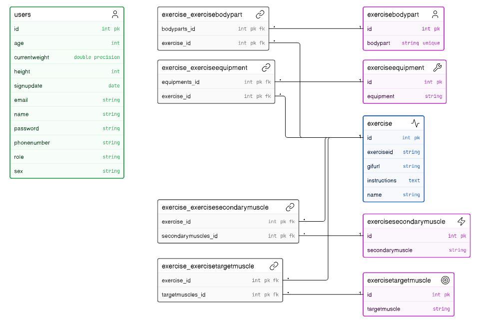

# RSLV

## Vision

This project is a backend API containing fitness exercises.
Every exercise contains information about it, a GIF and instructions on how it is performed.

The goal is to provide enough data for a beginner to understand and execute exercises while minimizing risk of injury.

---

## Links

Deployed application (optional):  
https://rslv.mstenvall.dk/api/v1

Source code repository:  
https://github.com/MathiasStenvall/RSLV/tree/main/src

Portfolio website:  
https://mathiasstenvall.github.io/portfolio/

---

# Architecture

## System Overview

This project's structure is divided into several layers, each having a single clear purpose:

- Controller layer (REST endpoints)
- Service layer (security, services and validation)
- DAO layer (database access)

Technologies used:

- Java
- Javalin
- JPA / Hibernate
- PostgreSQL
- Maven
- JWT authentication
- Lombok
- JUnit
- Hamcrest
- REST-assured
- Jackson
- SLF4J
- Bcrypt

---

## Architecture Diagram

The overall flow of this project goes as follows:

A client sends a request to an endpoint, which the corresponding controller handles. Depending on the endpoint, the request will be validated and will require JWT authentication and role authorization.
If the validations pass, the controller uses the corresponding DAO class to access the database and perform the desired operation. 
The client then receives an HTTP response, which contains the result message or an error message.

---

## Key Design Decisions

While decisions of all sizes were made under the development, some of the key decisions include:

**Structure:**
Classes are separated by responsibility.
This improves modularity and maintainability, and gives a better overview of the project.

**Database:**
Exercise information is sometimes shared, and I didn't want to flood my database tables with duplicates.
For this reason my exercise class has several ManyToMany relations. This keeps the tables clean, at the cost of having more tables (connecting tables).

**Security:**
Authentication is implemented with JWT tokens, and authorization is based on the user's role.
Whenever a user logs in, they receive a time-limited token based on their role. If they have a valid token with the required permissions, they can access endpoints that modify data.

**Exceptions:**
Exceptions are handled with an exception mapper.
This class contains the most thrown errors, alongside a catch-all for unexpected exceptions.
Each exception is logged, and an error message is returned to the client.

**Test:**
Tests are covered with an HTTP request file, JUnit and REST-assured.
These tests verify expected behavior, and run automatically in the CI/CD pipeline.
In order to completely separate my tests classes from my deployed project, they use their own "EntityManagerFactory" and "secret".

---

# Data Model

## ERD

---

## Important Entities

The two main classes in this project are:

### User

Represents a registered user in the system.

Fields:

- id
- name
- age
- role
- email
- password
- phoneNumber
- sex
- height
- currentWeight
- signupDate

### Exercise

Represents an exercise in the system.

Fields:

- id
- exerciseId
- name
- gifUrl
- bodyParts
- targetMuscles
- secondaryMuscles
- equipments
- instructions

---

# API Documentation

| Method | URL                          | Request Body (JSON) | Response (JSON)  | Error (e)                                                            |
|:-------|:-----------------------------|:--------------------|:-----------------|:---------------------------------------------------------------------|
| POST   | /api/v1/register             | User without id     | Success message  | 400: Bad Request, 409: UserAlreadyExists, 500: Internal Server error |
| POST   | /api/v1/login                | User without id     | JWT              | 400: Bad Request, 401: Unauthorized                                  |
| GET    | /api/v1/counter              |                     | requests counter |                                                                      |
| GET    | /api/v1/stats                |                     | API statistics   | 500: Internal Server Error                                           |
| GET    | /api/v1/exercise/{id}        |                     | Exercise as JSON | 400: Bad Request, 404: Not Found                                     |
| GET    | /api/v1/exercise?page={page} |                     | Exercise[20]     | 400: Bad Request                                                     |
| POST   | /api/v1/exercise             | Exercise without id | Exercise as JSON | 400: Bad Request, 403: Forbidden                                     |
| PUT    | /api/v1/exercise/{id}        | Exercise without id | Exercise as JSON | 400: Bad Request, 403: Forbidden, 404: Not Found                     |
| DELETE | /api/v1/exercise/{id}        |                     |                  | 400: Bad Request, 403: Forbidden, 404: Not Found                     |

# User Stories

The main user stories for this project are:

- As a user, I want to register an account.
- As a user, I want to log in and receive a token.
- As a user, I want browse exercises with an id-based pagination.
- As a user, I want to search a specific exercise by id.
- As an admin, I want to add a new exercise to the database.
- As an admin, I want to change an existing exercise.
- As an admin, I want to delete an existing exercise from the database.

---

# Development Notes

This project has introduced a lot of new concepts, and has turned out to be a big and enjoyable learning experience.
However, some concepts were more challenging than others, such as:

**JPA:**
Correctly implementing every relationship and annotations to make the class fit my exact needs,
didn't only require time, but I also had to come back several times to adjust while developing the project.

**CI/CD:**
Setting up the pipeline was a long process, it contained steps I hadn't worked with before, and since I wasn't familiar with them,
I didn't feel confident. Also, it requires several steps, which only gives more room for mistakes.

**JWT:**
Implementing JWT was a challenge, again it is divided into several steps, and while I understood the process,
there was a lot of new syntax.

That being said, overcoming these challenges has positively affected my confidence on how to approach and execute these new technologies.